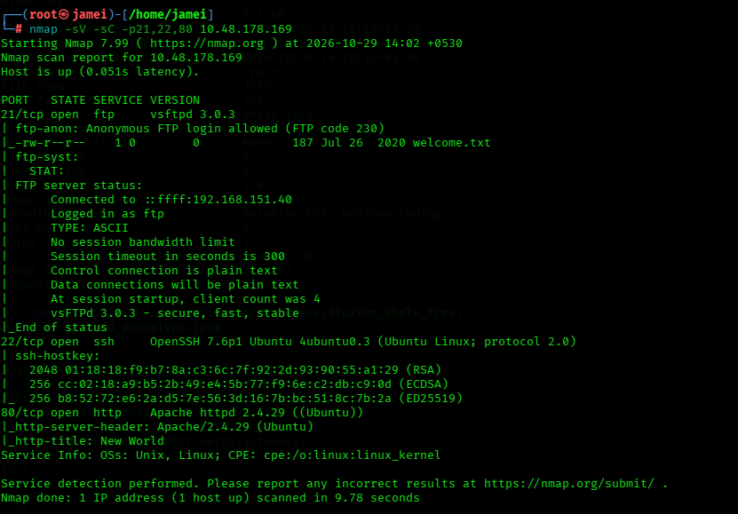

Difficulty Level: Medium

Skills Required to Solve the One Piece CTF — TryHackMe

1. Web Enumeration
2. Cryptography and Encoding
3. Linux Fundamentals
4. Web Application Security
5. Basic Scripting
6. Steganography and Digital Forensics

Recommended Tools

Burp Suite,
CyberChef,
Nmap,
Gobuster or FFUF,
Python,
Linux command-line utilities

Warning: If you are currently watching or reading One Piece and haven't completed the Zou arc yet, be aware that this room contains spoilers.

We need to scan the target to identify open ports, running services, and potential entry points.

The scan revealed three open ports on the target: 21 (FTP), 22 (SSH), and 80 (HTTP).
We can also observe that the FTP service allows anonymous login, making it the first service to investigate.

Port 21:FTP

