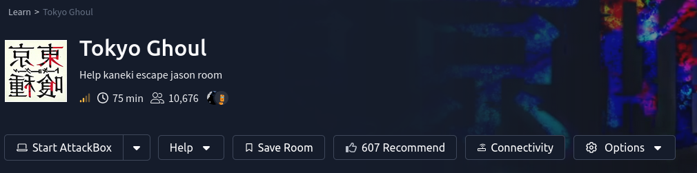
**Tokyo Ghoul TryHackMe**

**Machine Information**

Platform: TryHackMe

Machine: Tokyo Ghoul

Difficulty:medium

Category: Boot2Root

**Network Scanning**

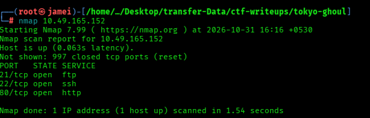

There are 3 open ports: 21, 22, and 80.
Port 21 allows anonymous login.

I opened the website running on port 80

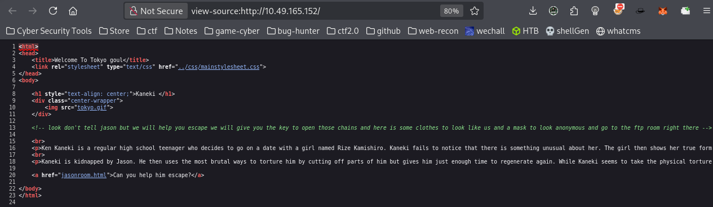

**The source code mentioned anonymous FTP login, so I decided to connect to the FTP server.**

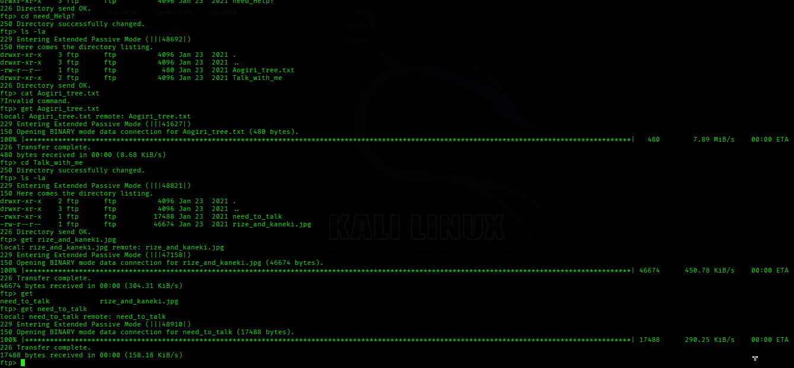

I found three files on the FTP server: aogiri_tree.txt, rize_and_kaneki.jpg, and need_to_talk.

I used the get command to download all three files to my machine. Now I will check these files.

-**need_to_talk**

Now, I will try to run these files.

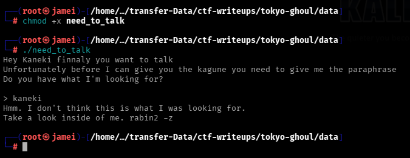

Now, I will use the strings command to check what is inside the need_to_talk file.

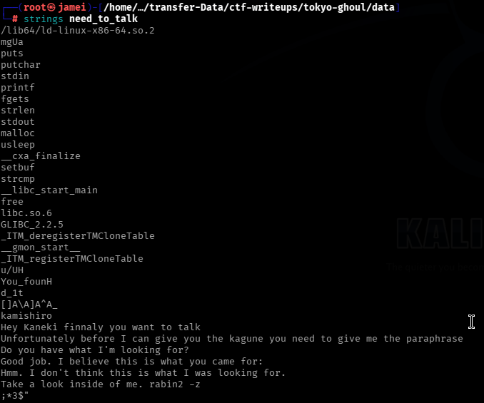

I ran the file again and entered Kamishiro as the keyword. It gave me the text You_found_1t. This might be a password to extract hidden data from the image.

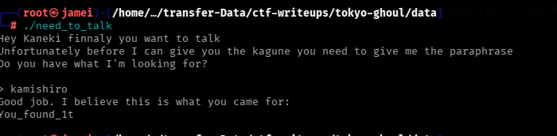

-**rize_and_kaneki.jpg**

I found a password and used it with steghide on the rize_and_kaneki.jpg image. It successfully extracted a file named yougotme.txt.

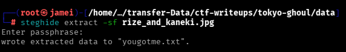

Now, I will use the cat command to check the contents of yougotme.txt.

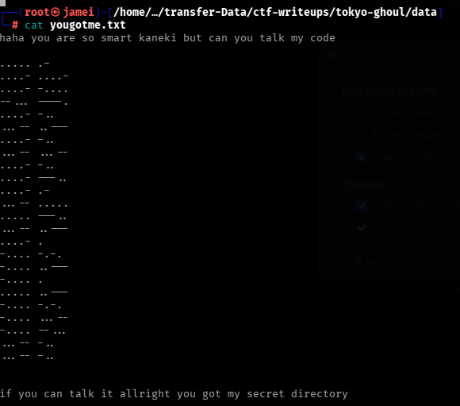

I found some Morse code. Let's decode it using the CyberChef website.

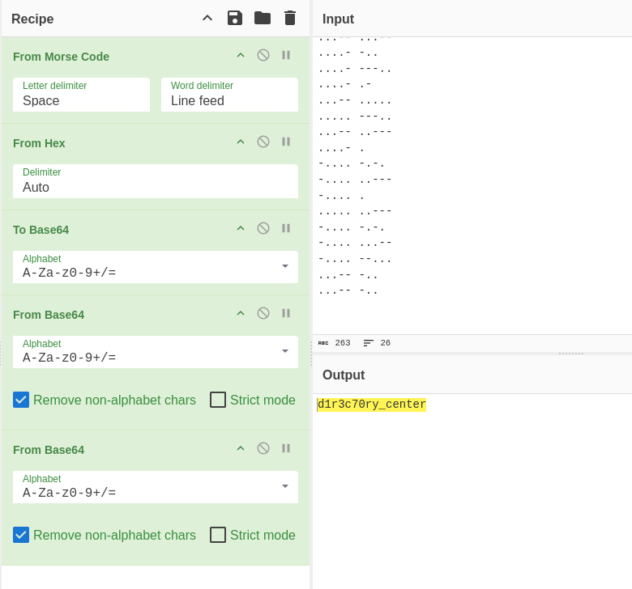

In CyberChef, I used the following steps to decode the message:

1. From Morse Code
2. From Hex
3. To Base64
4. From Base64
5. From Base64

**Now, we will use this message as an HTTP website directory.**

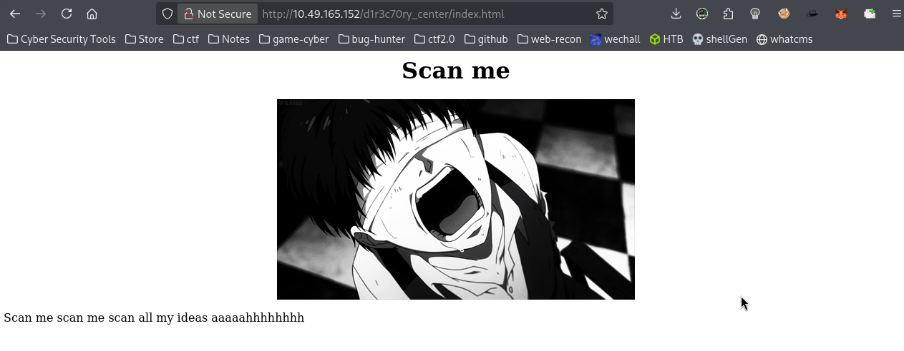

**Now, I will use DIRB to find hidden directories on the website.**

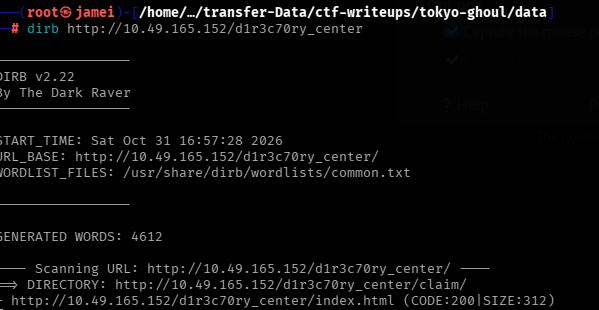

**After running DIRB, I found an endpoint in the claim directory.**

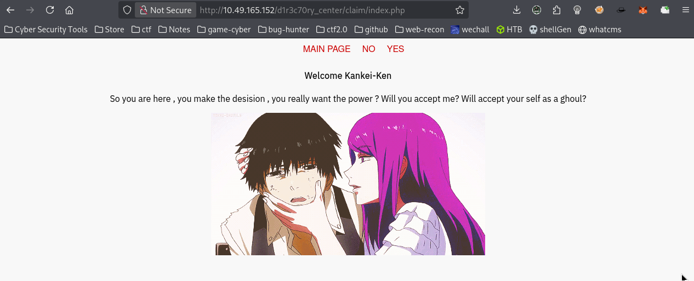
