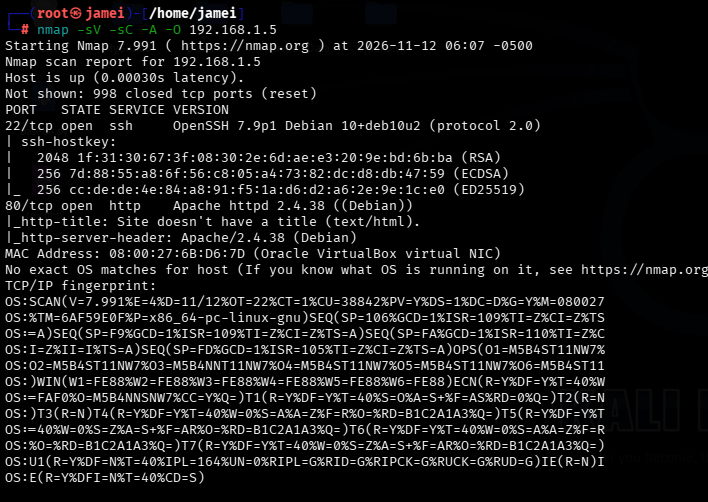
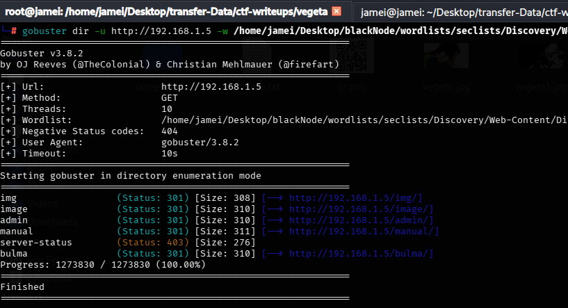
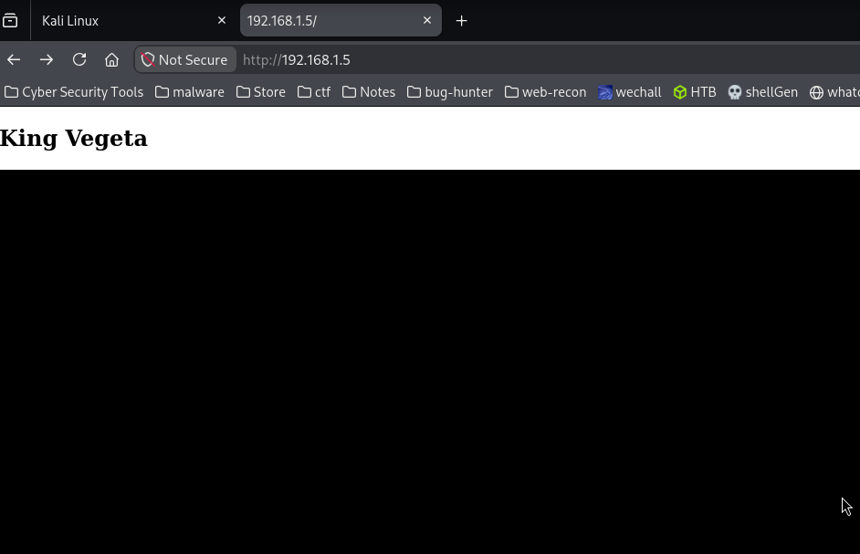
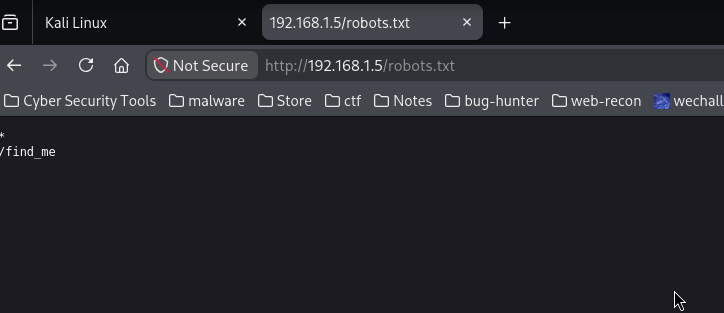
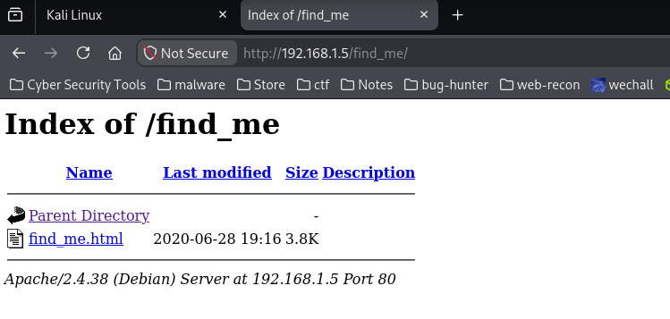
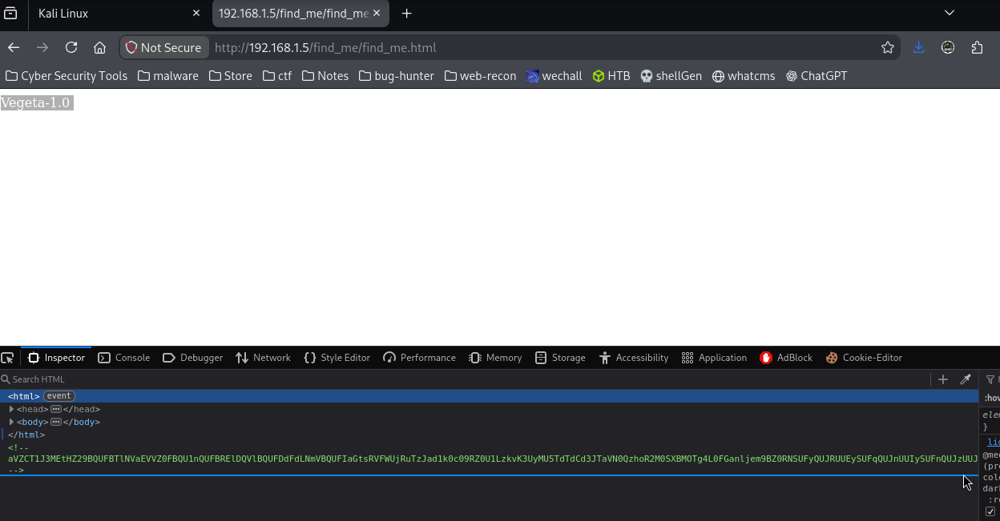
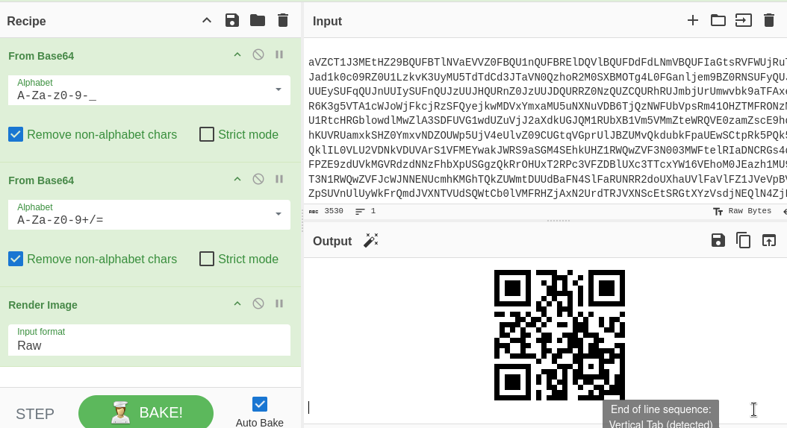
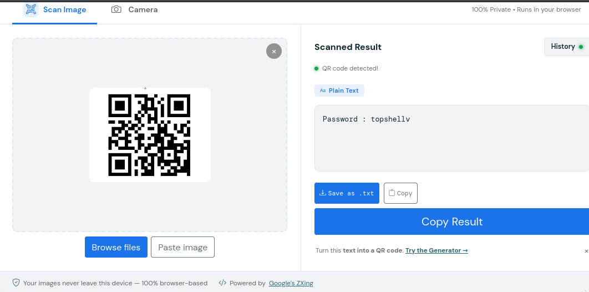
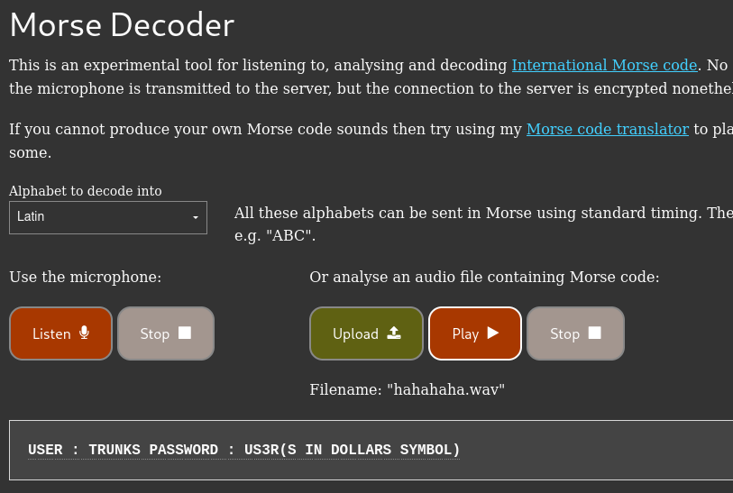
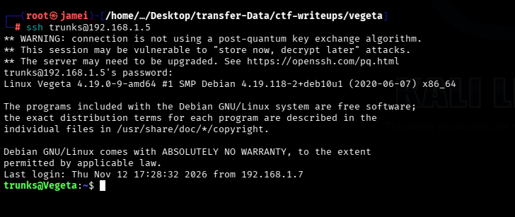

# Vegeta - VulnHub CTF

## Machine Information

- **Platform:** VulnHub
- **Machine:** Vegeta
- **Difficulty:** Beginner
- **Type:** Boot2Root
- **Goal:** Capture the user and root flags.

## Introduction

This writeup covers my walkthrough of the Vegeta machine from VulnHub.I will document the enumeration, exploitation, and privilege escalation steps taken during the assessment.

**Reconnaissance**

Started with Nmap to identify open ports and running services.

Used Nmap and found two open ports: 22 (SSH) and 80 (HTTP)

**Web Enumeration**

We used Gobuster on port 80 to find hidden directories and files on the web server

After finding directories with Gobuster, I opened the target website on port 80 to investigate further

We first checked the `robots.txt` file to look for any hidden paths or directories.

The robots.txt file revealed a directory named `/find_me`.

Inside `/find_me`, we found a file named `find_me_html`.

We found a Base64-encoded string in the page source code.

Decoded the Base64 string using CyberChef.

Decoded the Base64 string twice in CyberChef, then changed the output format to Raw. This generated a QR code.

After scanning the QR code, we found a password: `topshellv`.

Next, we checked another directory on the web server named `/bulme`.

Inside `/blume`, we found `hahahah.wav`. It was an MP3 audio file containing Morse code sounds.

I searched for an online Morse code decoder and used it to decode the Morse code sounds.

After decoding, we found a text containing a username and password.

We used the username and password to try logging in through SSH.

Successfully logged in via SSH using:

- **Username:** `trunks`
- **Password:** `u$3r`

